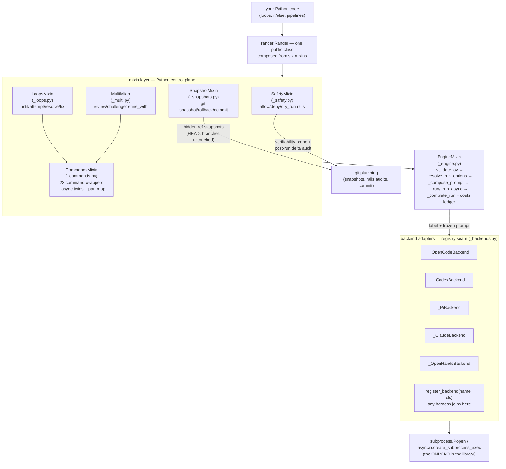
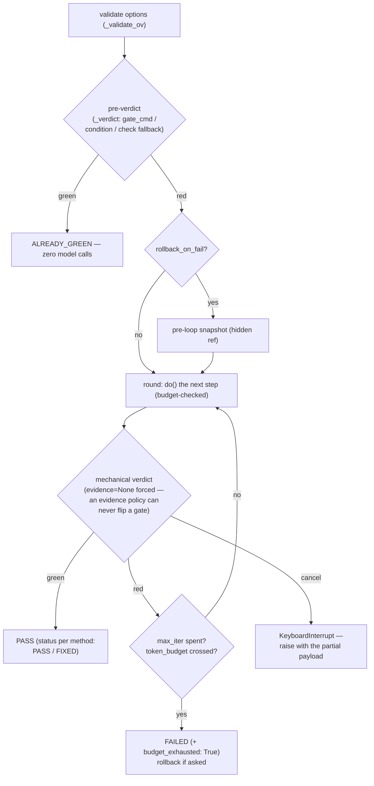
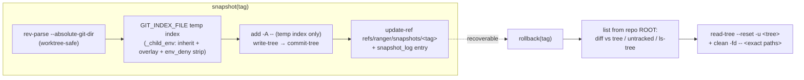

# ranger — system analysis (as-is audit)

Re-audited at `473e02f` (release 0.9.2) · 11 modules · 4045 raw LOC /
1778 LLOC · 204 functions · 17 classes · max cc 13 · avg cc 3.8 ·
docstring coverage 86% · pcina scan 9.41/10 · 515 green tests (~3.5 s).

Scope: `ranger` is an **agent-as-a-library** — one Python class, `Ranger`,
composed from six single-purpose mixins, that drives headless
coding-agent harness CLIs (opencode, codex, pi, openhands, claude) via
subprocess. There is no server, no queue, no runtime: Python owns
every loop. This audit documents the as-is architecture, the data
schemas, the responsibility matrix, the structural debt that was found
and since resolved, and what remains pinned by reviewed budget
decision (repo law: zero functional drift).

The previous audit (cycle 18, at `7f9b954`) ranked six refactoring
issues (#12–#17) — **all six have since landed** (see §6). This
document is the corrected, current record.

---

## 1. High-level architecture



### Entry points
- `ranger.Ranger(...)` — the single public class (45 public methods);
  everything else is package-internal. `ranger.debate(a, b, topic)` and
  `ranger.register_backend(name, cls)` are the only other top-level
  names; `ranger.RangerError`/`RangerTimeout`/`RangerHarnessError`,
  `ranger.DEFAULT_MODEL`, `ranger.backends()` complete the module API.
- No CLI, no REST routes, no background workers by design.

### End-to-end lifecycle of one call — `agent.do(goal)`

```mermaid
sequenceDiagram
    participant U as your code
    participant DO as do() / _commands
    participant V as _validate_ov
    participant G as _guard_do / _safety
    participant E as _run (EngineMixin)
    participant B as backend adapter
    participant H as harness CLI (subprocess)

    U->>DO: agent.do(goal, **ov)
    DO->>V: per-call options
    V--xDO: TypeError/ValueError — unknown key or bad value<br/>(BEFORE any git probe or snapshot: no phantom refs)
    DO->>G: rails active? resolve (allow, deny, dry)
    G->>G: git rev-parse --show-toplevel (verifiability probe)<br/>+ pre-run porcelain baseline {path: XY}
    DO->>DO: _auto_snapshot("pre-do") — best-effort, only if snapshots=True
    DO->>E: label="do", frozen prompt (_contracts._do_prompt) + ov
    E->>E: _resolve_run_options → _compose_prompt<br/>(grants + recall + request + effort directive)
    E->>B: build_cmd(o) → argv
    E->>H: spawn (own process group), stream progress
    H-->>E: stdout (JSONL / JSON / text per backend)
    E->>B: check_output_schema (drift refusal) + parse_output
    E->>E: _record_costs + context record + last
    E-->>DO: answer
    DO->>G: _check_do_after — post-run porcelain vs rails<br/>(DELTA against the baseline; override blame is a stated limit)
    G--xDO: RangerError on violation (tree left mutated — honest)
    DO-->>U: report
```

Steps in prose:

1. **Refuse-early validation** (`_validate_ov`, 0.9.2): unknown keys AND
   bad values die before any side effect; the same guard opens every
   loop (`until`/`attempt`/`resolve`/`fix`) before the pre-loop snapshot.
2. **Command wrapper** freezes the prompt contract
   (`_contracts._do_prompt`) and labels the run (`"do"`).
3. **Rails guard** (`_guard_do`): with `allow`/`deny` active (and not
   `dry_run`) the cwd must be a git repo; one pre-run
   `status --porcelain -z` snapshot becomes the blame baseline.
4. **Auto-snapshot** when `snapshots=True` — hidden git ref via a
   temporary index under the real git dir; never touches worktree or
   real index.
5. **Transport and completion** as in the sequence diagram — one seam,
   one subprocess per call; retry/interrupt/timeout contained with a
   process-group kill.
6. **Post-run audit**: the delta between two porcelain snapshots vs
   the rails — pre-existing dirt is never blamed on the agent.

## 2. The loop pattern (LoopsMixin)

`until`/`resolve`/`fix` share one bounded-run skeleton; verdicts are
mechanical (gate command, `check` grammar, or an explicit condition —
never an agent's self-report):



## 3. Snapshot lifecycle (SnapshotMixin)

Snapshots are git plumbing only: hidden refs under
`refs/ranger/snapshots/*`, a temporary index so staged state is never
disturbed, HEAD and branches untouched:



## 4. Data schemas (in-process contracts — there is no database)

| Schema | Shape | Where produced / consumed |
|---|---|---|
| Run options `o` (dict) | 23-key frozen set `_RUN_KEYS`: model, timeout, auto, session, agent, mode, title, thinking, pretty, memory, skills, effort, stats, backend, memory_budget, retries, env, allow, deny, dry_run, skills_budget, evidence, env_deny | `_validate_ov` (pure refusal) then `_resolve_run_options`; every transport/adapter reads `o` |
| Composed prompt string | grants block + recall block + request + effort directive | `_compose_prompt`; measured verbatim by `quote()` with zero spawns |
| Context history | `list[{"role", "content"}]` | recorded by dialogue commands; fact commands run pure (session dropped, recall skipped) |
| Costs ledger | `{"calls", "chars_in", "chars_out", "tokens_in", "tokens_out", "wall_s"}` | `_record_costs`; `agent.costs` / `costs_reset()`; feeds `token_budget` |
| Telemetry `info` | `{"model_s", "parts", "chars", "session", ...backend extras}` | adapter `parse_output`; surfaces via `agent.last`; `check_output_schema` refuses silent drift |
| Verdict gate evidence | `{"kind": gate\|condition\|check, "ok", "output"}` (+ `parts` for gate lists) | `_verdict` — mechanical only |
| until/attempt/resolve/fix result | `{"achieved"/"status", "iterations", "last_gate", "report", ...}` (+ `budget_exhausted`, `rolled_back`/`rollback`) | LoopsMixin |
| Multi-agent results | PASS/FAIL/UNCERTAIN table (verify_claims); VERDICT/FINDINGS/CHANGES (review); attack/defense transcript (challenge); approved+reviews (refine_with) | MultiMixin (`_contracts.py` grammars) |
| Snapshot log | `list[{"tag", "sha", "tree", "time"}]` on the instance; hidden refs + temp index files | `_snapshots.py` |
| Rails baseline | `dict[path -> XY]` from two `status --porcelain -z` snapshots | `_guard_do` / `_check_do_after` — delta-only blame |
| Backend registry | `dict[name -> adapter class]` over `_Backend` (name, install_hint, native_file_skills, build_cmd, parse_output, list_models, check_output_schema) | `_backends.py` / `ranger.register_backend` |

## 5. Communication boundaries

- **Ranger → harness CLIs:** argv (`build_cmd`) / stdout parsing
  (`parse_output`) per backend; the only network/IO surface. JSONL for
  opencode, JSONL event stream for codex, JSON object for claude,
  plain text for pi/openhands. Total non-recognition of a non-empty
  stream raises (issue #32 drift guard, codex joined in 0.9.1).
- **Ranger → git:** `_snapshots.py` + `commit()` shell out to git
  (add/write-tree/commit-tree/update-ref, read-tree --reset, status
  --porcelain -z, clean -fd -- paths) — all run from the repo ROOT so
  a subdirectory cwd is never a subtree trap. Safety rails are
  pure-Python fnmatch predicates; the `_child_env` env_deny rail
  strips denied names even from explicit overlays, and the temp-index
  env inherits exactly the child-CLI treatment.
- **Mixins → engine:** mixin methods call `self._run(...)`; mutation
  flows through EngineMixin helpers; per-instance state is explicit
  (`self.context`, `self._costs`, `self.snapshot_log`).
- **Tests → library:** the mock seams — `ranger._engine._Popen`
  (sync transport), `ranger.subprocess.run` (git plumbing, models
  listing), `ranger.subprocess.Popen` (gate),
  `asyncio.create_subprocess_exec` (async twin). 515 fully mocked
  tests pin prompts and outputs byte-for-byte; enforced budget 60 s,
  suite runs in ~3.5 s.

## 6. Module responsibility matrix

| Module | Lines | Actual responsibility | Verdict |
|---|---:|---|---|
| `__init__.py` | 303 | class assembly (6 mixins), ctor option validation, stale-model warning, `__repr__`, re-exports | clean |
| `_engine.py` | 707 | run pipeline: `_validate_ov` → options → skills → compose → spawn (sync+async) → complete; costs ledger; `_child_env` env_deny rail | heaviest module by intent: the transport IS the job; `_validate_ov` (0.9.2) keeps all refusal pure and early |
| `_commands.py` | 745 | 23 public command wrappers + `quote()` + `gate()` + `models()`/`with_config()` + write/edit spec seams shared by async twins | homogeneous thin wrappers; `with_config` (cc 13) carries the API-frozen option matrix |
| `_backends.py` | 618 | 5 CLI adapters over the `_Backend` contract + registry + drift guard | clean seam; adapters differ only in argv/parse |
| `_contracts.py` | 248 | frozen prompt texts, verdict grammars, effort/purity tables | the de-facto spec; excellent isolation |
| `_loops.py` | 641 | until/attempt/resolve/fix over one bounded-run skeleton; mechanical `_verdict` | the cc-11 twins were unified (issue #14) |
| `_multi.py` | 462 | verify_claims/review/challenge/second_opinion/refine_with | grammar-driven; round body extracted (issue #15); 0.9.1 stamped `evidence=None` so policy can never flip a verdict |
| `_safety.py` | 112 | rails resolution, path predicates, baseline-delta post-check | clean |
| `_snapshots.py` | 344 | snapshot/rollback/commit over git plumbing, root-scoped | clean |
| `_debate.py` | 93 | debate() + judge digest | clean |
| `_util.py` | 307 | exception taxonomy, named constants/clips, porcelain -z parser, patterns, spinner, kill-tree | grab-bag by definition; every frozen number lives here |

No circular imports (mixins import only `_util`/`_contracts`/
`_backends`); the adapter registry is the only inversion point, by
design.

## 7. Debt found by the first audit — resolution record

| Issue (as-is audit / cycle 18) | Status |
|---|---|
| #12 `par_map` cc 14 — assembly/validation split | **resolved** — prep layer out of `par_map`, raises stay at the boundary |
| #13 `_resolve_run_options` cc 13 — merge/raise split | **resolved** — pure merge helper; 0.9.2 layered `_validate_ov` on top for the mutating commands |
| #14 `until`/`resolve` cc 11 — shared skeleton | **resolved** — one bounded-run iterator, own stop conditions |
| #15 `refine_with` cc 12 — round body | **resolved** — extracted |
| #16 backend adapter docs | **resolved** — twelve docstrings, parse/build contracts written out |
| #17 nine depth-3 guards | **resolved** — all inverted, byte-identical |

## 8. What remains — and why it stays

Honest residue at scan 9.41, all reviewed budget decisions
(`pcina.toml` pins the measured maxima; aggravation fails CI,
reduction is always welcome):

1. **God-object tension is intentional**: `Ranger` is one class by
   public-API law; the mixin split already separates the six axes.
2. **`with_config` cc 13, `Ranger.__init__` 22 params**: API-frozen
   signatures, pinned by docs gates and truth-table tests.
3. **~43 pinned warns** (fn spans, param counts, raise-guards at trust
   boundaries): the raise budget is law 5 (never guess — parse or
   raise); borders are the right place for guards.
4. **`_Spinner` dead-code flag**: false positive — it resolves through
   the package and doubles as the documented mock seam; do not delete.
5. **Stated limits, not lies**: the do-rails delta cannot see an agent
   re-modification that leaves the porcelain XY pair unchanged; the
   class docstring says so (inherent to judging by `git status`).
6. **Windows kill degradation**: without `os.killpg` containment kills
   the direct child only — documented, pinned, honest.

The 2026-11-04 second-pass audit (cycles 10–13) and the 0.9.2 review
fix landed on top of this list; see
[growth-log.md](growth-log.md) for the cycle trail and
[ARCHITECTURE.md](ARCHITECTURE.md) for the repository map.
